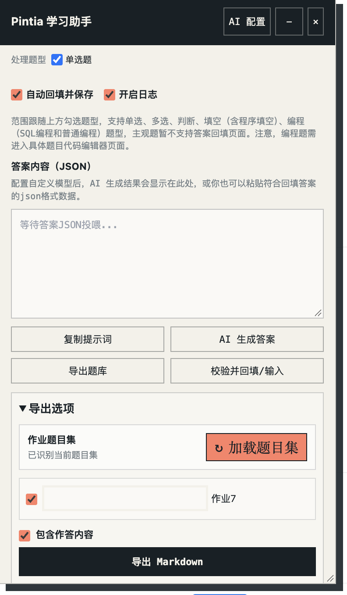
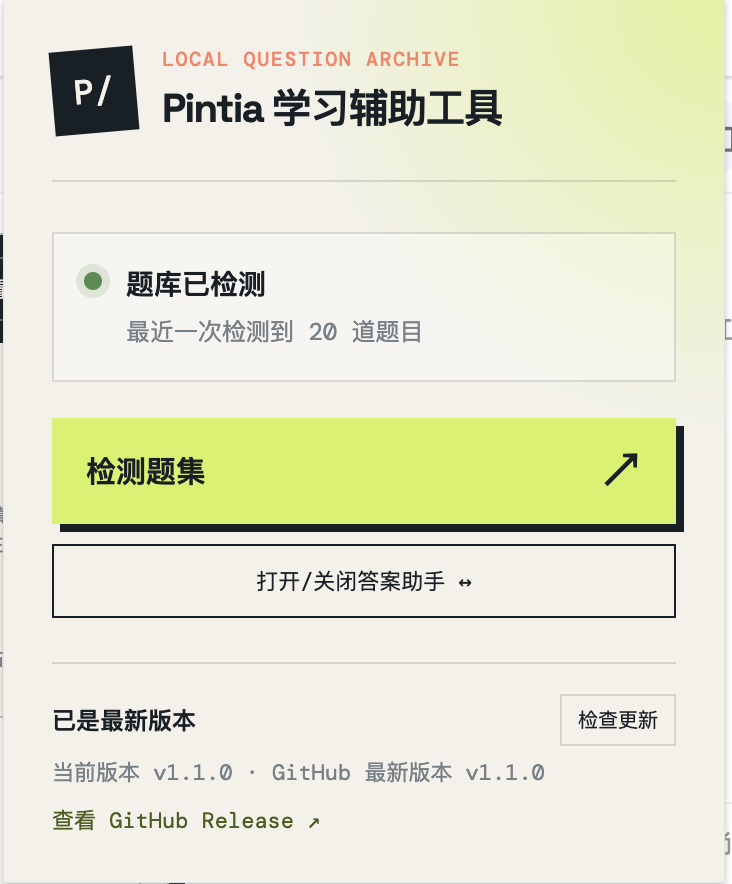
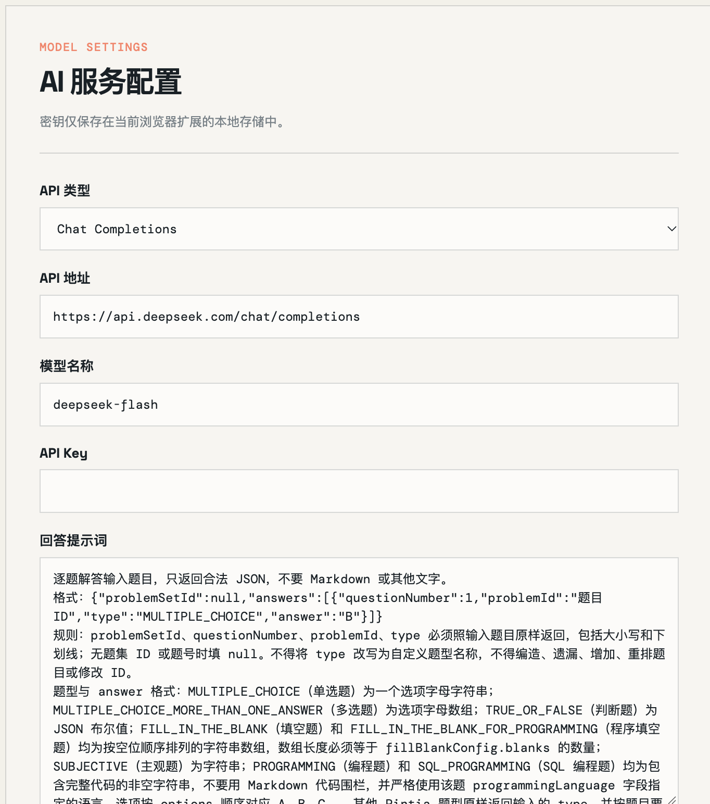

# Pintia 学习辅助工具

面向 Chrome 和 Edge 的浏览器扩展，可从 Pintia 题集提取并导出题目，也可在你主动操作后生成答案、检查答案并回填到页面。

## 快速开始

1. 在 Chrome 打开 `chrome://extensions`，或在 Edge 打开扩展管理页，开启「开发者模式」。
2. 点击「加载已解压的扩展程序」，选择本项目根目录。
3. 在同一浏览器打开 [Pintia](https://pintia.cn/) 并登录；助手会在 Pintia 页面自动打开。
4. 助手只会在题集概览页或具体题目页识别当前题目集。需要导出 Markdown 时，可从这两类页面开始；点击「加载题目集」后才会读取完整题集列表。
5. AI 答题、答案回填和当前题库 JSON 导出需要进入具体题目页。选择作业导出 Markdown、复制提示词交给外部 AI、配置 AI 服务生成答案，或粘贴已有答案 JSON。
6. 默认关闭自动回填时，等待最终答案（若开启答案复核，则等待复核完成），检查答案和题型选择后手动启动「校验并回填/输入」；若主动开启「自动回填并保存」，则会在最终答案生成后自动校验、回填并保存，开启复核时会等待复核完成。

## 界面预览

### Pintia 页面助手

在 Pintia 页面打开的助手面板，可用于生成、检查和回填答案，也可导出题库。

### 扩展弹窗

点击浏览器工具栏中的扩展图标，可检测题集或打开、关闭答案助手。

### AI 服务配置

在配置页填写 API 类型、地址、模型和密钥，并可自定义答题提示词。

## 页面与功能范围

- 登录后，助手可在任意 Pintia 页面打开；只有题集概览页和具体题目页会识别当前题目集。
- 「导出Markdown」可从题集概览页或具体题目页开始。点击「加载题目集」后才会读取完整列表，之后可选择一个或多个题集导出。
- AI 答题、回填和当前题库 JSON 导出需在具体题目页使用。

## 检查更新

打开扩展弹窗时会检查 GitHub 仓库的最新 Release；检查结果缓存 6 小时，也可点击「检查更新」立即查询。发现新版本后，点击 Release 链接下载 ZIP、解压到本地目录，再到 Chrome/Edge 扩展管理页加载新版目录（或重新加载扩展）。本功能只提示新版本，不会自动覆盖本地文件或自动安装更新。

## 使用前请注意

- AI 生成由用户主动发起；默认需检查答案后手动回填。AI 答案可能有误，请先核对题集、答案和题型。
- 「自动回填并保存」默认关闭。开启后，AI 返回的最终答案会自动写入并保存；请只在确认配置和题型范围正确时启用。
- 高级设置中的「答案复核」默认关闭；开启后会让模型重新解题并审阅初稿，复核结果仍需检查，不能保证正确。
- 编程题和 SQL 编程题需要先在 PTA 编辑器中选择与助手一致的语言，并将光标放到目标编辑器中。
- 多题型回填可能需要切换 PTA 分类，助手会在执行前提示并逐类保存。单一题型手动回填是否保存由「自动回填并保存」开关控制。
- AI 服务配置和 API Key 保存在浏览器扩展本地存储中。只有点击 AI 生成或复核时，相关题目数据才会发送到你配置的服务。
- 开启日志后，可在助手面板查看当前页面会话中的导出、AI 请求和回填诊断信息；日志不记录题目、答案或密钥。
- 本工具不会读取隐藏答案或绕过 Pintia 登录。请确认使用方式符合课程及平台规定。

## 题型支持

| 题型 | 答案格式示例 | 页面回填 |
| --- | --- | --- |
| 单选题 | `"B"` | 支持 |
| 多选题 | `["A", "C"]` | 支持 |
| 判断题 | `true` 或 `false` | 支持 |
| 填空题 | `["Java", "Spring Boot"]` | 支持 |
| 程序填空题 | `["ellipse", "center", "1000px"]` | 支持 |
| 编程题 | `"完整源代码"` | 支持，需匹配 PTA 编辑器语言并预先聚焦编辑器 |
| SQL 编程题 | `"SELECT ..."` | 支持，需匹配 PTA 编辑器语言并预先聚焦编辑器 |
| 主观题 | `"答案文本"` | 暂不支持；会跳过回填 |

答案 JSON 的 `type` 使用 Pintia 原始大写题型名；完整题型标识、字段要求和校验规则见[答案 JSON 格式](docs/answer-json-contract.md)。

## 文档

- [产品说明与完整使用流程](docs/product.md)：功能、AI 设置、题型支持、数据处理和常见限制。
- [答案 JSON 格式](docs/answer-json-contract.md)：粘贴或提交给 AI 的答案格式、题型字段和校验规则。
- [题库导出格式](docs/question-export-format.md)：下载的题库 JSON 结构、图片字段和数据来源。
- [导出Markdown](docs/question-export-format.md#导出-markdown)：每个题集导出一个 Markdown 文件；可选择是否包含平台返回的最近作答（不是标准答案），批量导出时可设置请求间隔。不会推测标准答案。
- [答案回填设计](docs/answer-fill-design.md)：回填定位、验证、保存和执行报告细节。
- [开发规约](docs/development-guidelines.md)：项目结构、开发与发布说明。

## 问题排查

- **当前页面没有识别题集**：导出 Markdown 时切换至题集概览页或具体题目页，并点击「加载题目集」读取完整列表；使用 AI 答题、回填或导出当前题库 JSON 时，进入具体题目页。
- **页面尚未就绪或没有检测到题目**：确认题目已加载；刷新页面后重新检测。
- **未检测到登录状态**：在当前 Pintia 标签页登录，刷新后再检测；确认账号有权访问该作业。
- **扩展更新后无法使用**：刷新已打开的 Pintia 标签页，使新版内容脚本生效。

## 免责声明

本工具仅供个人学习与技术交流使用。使用者应自行确认使用本工具符合所在课程及平台的相关规定，并对使用本工具产生的内容、操作及后果负责。AI 生成内容可能存在错误，开发者不对其准确性或完整性作出保证。
