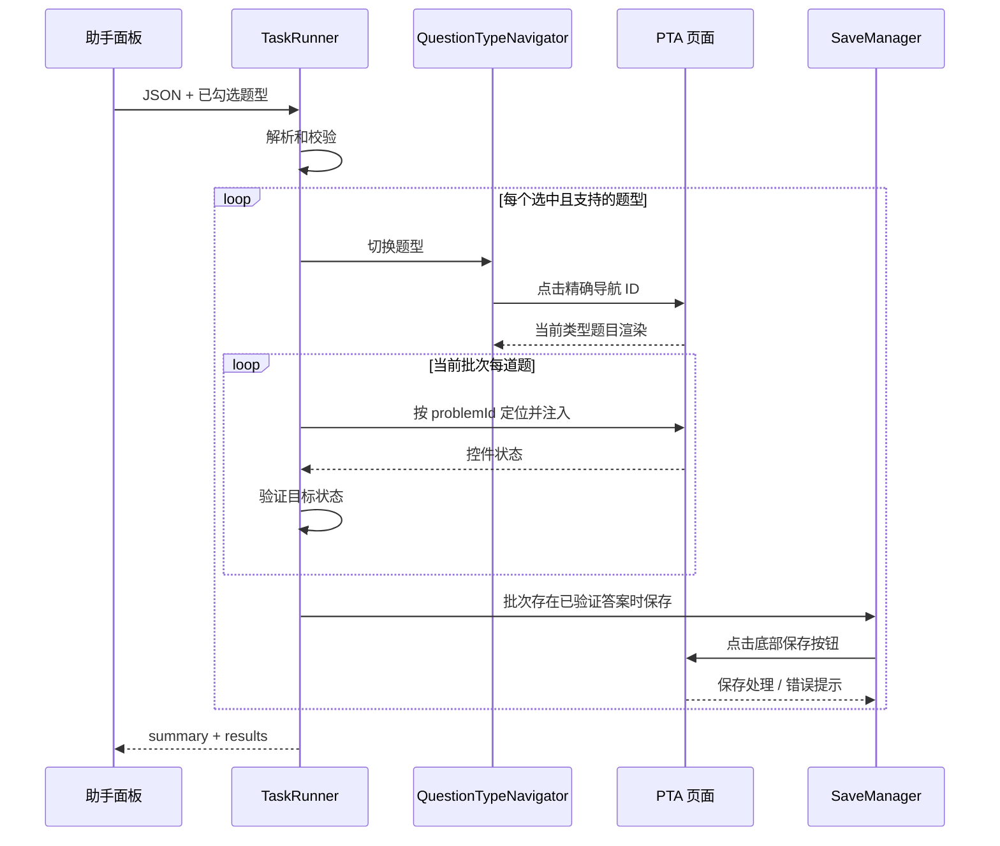

# 答案回填设计

## 目标与约束

实现从答案 JSON 到 PTA 作答状态的确定性路径：

`JSON -> 校验 -> 按题型导航 -> problemId 定位 -> 注入 -> 验证 -> 保存 -> 执行报告`

当前只回填单选、多选、判断和填空。题目位置必须由 `problemId` 确定；不使用题号、题干或选项文案猜测位置。执行按题型串行，单题失败不阻止同批其他题或后续题型。

## 代码职责

| 职责 | 当前实现位置 | 责任 |
| --- | --- | --- |
| 答案解析与校验 | `AnswerParser`、`AnswerValidator`，位于 `src/content/answer-runner.js` | 解析 JSON；校验题集 ID、数组、题目 ID、题号、题型和答案形状。 |
| 类型导航 | `QuestionTypeNavigator`，位于 `src/content/answer-runner.js` | 依据标准题型点击 PTA 左侧精确 ID 的 `<a>`，等待当前题型题目可见。 |
| 题目定位 | `QuestionResolver`，位于 `src/content/answer-runner.js` | 使用 `document.getElementById(problemId)` 定位题目根容器。 |
| 答案注入 | 四个 `*Injector`，位于 `src/content/answer-runner.js` | 各题型调用对应 PTA 输入控件并触发页面状态更新。 |
| 回填验证 | `AnswerVerifier`，位于 `src/content/answer-runner.js` | 对照目标答案检查控件实际状态。 |
| 保存 | `SaveManager`，位于 `src/content/answer-runner.js` | 点击 PTA 底部保存按钮、等待处理并检查新增错误提示。 |
| 任务编排 | `TaskRunner`，位于 `src/content/answer-runner.js` | 应用题型筛选、按类型分批执行、隔离错误并汇总报告。 |
| 用户交互 | `src/content/assistant-panel.js` | 编辑/粘贴 JSON、复用题型勾选框、启动执行并展示结果。 |

虽然职责在同一脚本内定义，但逻辑按对象职责拆分，避免为每个职责额外引入独立文件和加载顺序。

## PTA 题型导航

题型导航使用 `<a id>` 精确定位，不使用文本搜索。当前 ID 映射如下：

| 标准题型 | PTA 左侧导航 ID |
| --- | --- |
| `single_choice` | `MULTIPLE_CHOICE` |
| `multiple_choice` | `MULTIPLE_CHOICE_MORE_THAN_ONE_ANSWER` |
| `true_false` | `TRUE_OR_FALSE` |
| `fill_blank` | `FILL_IN_THE_BLANK` |

其中 PTA 单选导航 ID 虽然叫 `MULTIPLE_CHOICE`，映射以实际页面 DOM 为准，而不是根据 ID 名称推导题型。

执行某题型批次前，导航器先检查该批答案中的任一 `problemId` 是否已对应可见题目。若没有，则点击对应导航锚点，并最多等待 5 秒，每 100 毫秒检查一次题目是否出现。若导航控件不存在、点击失败或题目未加载，批次内题目会返回失败原因，不尝试模糊定位。

## 执行流程

1. 助手解析答案文本，并将当前勾选的题型传给任务执行器。
2. 校验整个 JSON。格式或字段不合法时，在启动回填前返回错误。
3. 将未勾选类型记为跳过；将 `programming`、`short_answer` 和未知类型记为不支持并跳过。
4. 按 `single_choice -> multiple_choice -> true_false -> fill_blank` 顺序处理选中且受支持的类型。
5. 切换到对应 PTA 分类，等待当前题型问题根容器可见。
6. 对每题按 `problemId` 定位，注入并立即验证；异常记录为该题失败，不使任务整体崩溃。
7. 若该批至少一题验证成功，调用一次 `SaveManager.save()`。保存失败会将该批已验证成功的结果改为失败。
8. 返回按输入答案顺序排列的逐题结果及总数。



## 注入和验证规则

### 单选题

按 `input-radio-option-{problemId}-{option}` 取 radio，并要求 `name` 等于 `problemId` 且控件属于题目根容器。目标未选中时调用 `click()`；之后检查 `checked`。

### 多选题

枚举题目根容器下属于该 `problemId` 的 checkbox。逐个计算 `shouldBeChecked = desiredAnswers.has(option)`，仅当当前值与目标值不同时点击。验证时比较实际选中集合和目标集合，要求完全相同。

### 判断题

将 `true` 转为 `TRUE`，`false` 转为 `FALSE`，复用单选注入和验证。

### 填空题

按 `data-blank-index` 的数字索引对应答案数组下标。通过原生 value setter 写值，并派发冒泡的 `input`、`change` 事件；随后逐空比较 `input.value`。

## 保存行为

`SaveManager` 仅在某题型批次至少有一题通过注入验证后运行。它查找 `button[data-e2e="problem-set-bottom-submit-btn"]`，点击并等待 500 毫秒，然后检查新出现的 `[role="alert"]` 文本是否包含常见失败/错误信号。

如果按钮不存在或点击/等待异常，该批已成功注入的题目会被报告为保存失败。当前没有针对 PTA 服务端持久化状态的独立确认机制；PTA 改变按钮或提示结构时需要更新此模块。

## 执行报告

报告结构：

```json
{
  "success": false,
  "problemSetId": "2103814750050508800",
  "summary": {
    "total": 3,
    "success": 1,
    "failed": 1,
    "skipped": 1
  },
  "results": [
    {
      "questionNumber": 1,
      "problemId": "2103815555000360960",
      "type": "single_choice",
      "success": true
    },
    {
      "questionNumber": 2,
      "problemId": "2103815555000360961",
      "type": "fill_blank",
      "success": false,
      "reason": "question container not found"
    },
    {
      "questionNumber": 3,
      "problemId": "2103815555000360962",
      "type": "programming",
      "success": false,
      "skipped": true,
      "reason": "unsupported question type"
    }
  ]
}
```

- `success` 仅当没有失败且没有跳过项时为 `true`。
- `failed` 统计执行或保存失败的题目；`skipped` 统计未勾选或不支持的题目。
- 单题错误包含 `questionNumber`、`problemId`、`type` 和 `reason`。
- 报告中的成功代表页面控件通过本地状态验证且题型批次保存流程未报告失败，不代表对服务端成绩或最终提交状态的独立证明。

## 修改和验证建议

- PTA 变化时先检查题型锚点 ID、题目根容器 ID、radio/checkbox ID、空位标记及底部保存按钮。
- 修改导航映射后验证每种类型均只点击对应锚点，并且等待的是目标 `problemId` 可见。
- 注入器变更应覆盖重复执行、已有选中状态、多选需要取消旧选项、缺失选项/题目和输入事件。
- 当前仓库未配置独立自动化测试命令；代码改动至少运行 `node --check src/content/answer-runner.js`，并在可用的 PTA 测试题集上进行手动验证。
