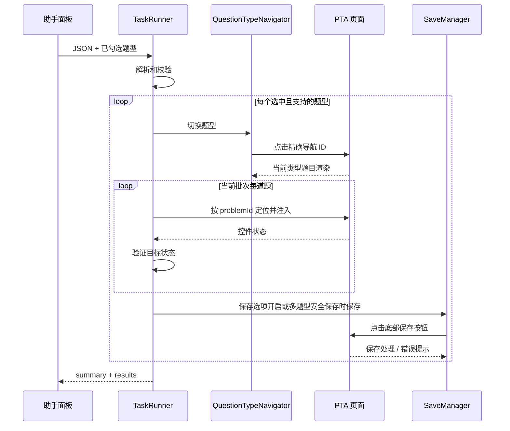

# 答案回填设计

## 目标与约束

实现从答案 JSON 到 PTA 作答状态的确定性路径：

`JSON -> 校验 -> 按题型导航 -> problemId 定位 -> 注入 -> 验证 -> 保存 -> 执行报告`

当前回填单选、多选、判断、普通填空和程序填空，并支持按 `problemId` 在题目容器中定位代码编辑器，将编程答案逐字输入到操作前记录的光标位置。若页面没有题目容器，单题答案可回退到页面唯一可见代码编辑器；答案包含多道编程题时，按当前 URL 中与题目 ID 完全匹配的项只回填当前页题目，其他题目标记为跳过。程序填空在题目容器的 `.cm-content` 中按 DOM 顺序定位输入框，答案项必须与页面输入框数量一致，并逐空写入、验证。题目位置不使用题号、题干或选项文案猜测。执行按题型串行，单题失败不阻止同批其他题或后续题型。

## 代码职责

| 职责 | 当前实现位置 | 责任 |
| --- | --- | --- |
| 答案解析与校验 | `AnswerParser`、`AnswerValidator`，位于 `src/content/answer-runner.js` | 解析 JSON；校验题集 ID、数组、题目 ID、题号、题型和答案形状。 |
| 类型导航 | `QuestionTypeNavigator`，位于 `src/content/answer-runner.js` | 依据 Pintia 原始题型点击左侧精确 ID 的 `<a>`，等待当前题型题目可见。 |
| 题目定位 | `QuestionResolver`，位于 `src/content/answer-runner.js` | 使用 `document.getElementById(problemId)` 定位题目根容器。 |
| 答案注入 | `*Injector`，位于 `src/content/answer-runner.js` | 各题型调用对应 PTA 输入控件并触发页面状态更新；编程题按 `problemId` 在题目容器内定位代码编辑器，并逐字输入到操作前记录的光标位置。 |
| 回填验证 | `AnswerVerifier`，位于 `src/content/answer-runner.js` | 对照目标答案检查控件实际状态。 |
| 保存 | `SaveManager`，位于 `src/content/answer-runner.js` | 点击 PTA 底部保存按钮、等待处理并检查新增错误提示。 |
| 任务编排 | `TaskRunner`，位于 `src/content/answer-runner.js` | 应用题型筛选、按类型分批执行、隔离错误并汇总报告。 |
| 用户交互 | `src/content/assistant-panel.js` | 编辑/粘贴 JSON、复用题型勾选框、启动执行并展示结果。 |

虽然职责在同一脚本内定义，但逻辑按对象职责拆分，避免为每个职责额外引入独立文件和加载顺序。

## PTA 题型导航

题型导航使用 `<a id>` 精确定位，不使用文本搜索。当前 ID 映射如下：

| Pintia `type` | PTA 左侧导航 ID |
| --- | --- |
| `MULTIPLE_CHOICE` | `MULTIPLE_CHOICE` |
| `MULTIPLE_CHOICE_MORE_THAN_ONE_ANSWER` | `MULTIPLE_CHOICE_MORE_THAN_ONE_ANSWER` |
| `TRUE_OR_FALSE` | `TRUE_OR_FALSE` |
| `FILL_IN_THE_BLANK` | `FILL_IN_THE_BLANK` |
| `FILL_IN_THE_BLANK_FOR_PROGRAMMING` | `FILL_IN_THE_BLANK_FOR_PROGRAMMING` |

题型字段与 PTA 导航 ID 保持一致。`MULTIPLE_CHOICE` 在此表示单选题；多选题使用 `MULTIPLE_CHOICE_MORE_THAN_ONE_ANSWER`。

执行某题型批次前，导航器先检查该批答案中的任一 `problemId` 是否已对应可见题目。若没有，则点击对应导航锚点，并最多等待 5 秒，每 100 毫秒检查一次题目是否出现。若导航控件不存在、点击失败或题目未加载，批次内题目会返回失败原因，不尝试模糊定位。

`PROGRAMMING` 和 `SQL_PROGRAMMING` 不执行导航，避免切换题型或题目时丢失当前代码编辑器的焦点。执行前记录助手面板外最近聚焦的文本输入框、文本域或可编辑区域及光标位置；执行时根据当前题目的 `problemId` 在题目容器中查找代码编辑器，不依赖助手面板打开后编辑器仍保持焦点。对于 CodeMirror 编辑器，恢复已记录的光标位置后通过文本插入命令逐字符输入，使编辑器自身处理输入和状态更新。编程答案必须是非空字符串。多个编程题答案中，仅能够定位到目标编辑器且具有有效光标位置的答案会输入，其余会报告失败或跳过。

检测到 `PROGRAMMING` 或 `SQL_PROGRAMMING` 时，助手面板显示并持久化保存语言选择；复制提示词和请求 AI 前必须选择语言，所选语言会附加到每道编程题的 `programmingLanguage` 和 `languageInstruction` 字段。扩展不会自动操作 PTA 编辑器的语言选择器，用户必须手动将编辑器语言切换为相同语言。

`PROGRAMMING`、`SQL_PROGRAMMING` 和 `SUBJECTIVE` 提取兼容题集的 `/exam-problem-list` 列表接口和 `/exam-problems/{problemId}` 详情接口：列表提供题目 ID/序号，扩展逐题请求详情并以 `content`/`description` 等正文作为题干。复制提示词和 AI 请求仅使用已取得题干的题目；编程题详情不可用时明确阻止发送不完整编程题。传给模型的编程配置只包含时间/内存/代码长度限制、样例测试数据、输入输出说明及编译器，不包含隐藏测试点、答案或题解。

## 执行流程

1. 助手解析答案文本，并将当前勾选的题型传给任务执行器。
2. 校验整个 JSON。格式或字段不合法时，在启动回填前返回错误。
3. 忽略未勾选类型，不加入执行报告；将所选的 `SUBJECTIVE` 和其他未实现类型记为不支持并跳过。
4. 优先处理选中的 `PROGRAMMING`、`SQL_PROGRAMMING`，然后按 `MULTIPLE_CHOICE -> MULTIPLE_CHOICE_MORE_THAN_ONE_ANSWER -> TRUE_OR_FALSE -> FILL_IN_THE_BLANK -> FILL_IN_THE_BLANK_FOR_PROGRAMMING` 顺序处理其他受支持类型。
5. 编程题使用已记录的网页光标直接逐字输入；其他题型切换到对应 PTA 分类，等待当前题型问题根容器可见。
6. 对每题按 `problemId` 定位，注入并立即验证；异常记录为该题失败，不使任务整体崩溃。
7. 若该批至少一题验证成功且保存选项开启，调用一次 `SaveManager.save()`。当答案实际涉及多个可回填题型且保存选项关闭时，面板须在执行前征求确认；确认后每批均保存，以免切换题型时丢失修改。仅涉及一种题型时，用户可选择保存或仅修改页面控件而不保存。多题型强制保存失败时停止后续题型导航，并将未执行的题目标记为失败。
8. 返回按输入答案顺序排列的逐题结果及总数。



## 注入和验证规则

### 单选题

按 `input-radio-option-{problemId}-{option}` 取 radio，并要求 `name` 等于 `problemId` 且控件属于题目根容器。目标未选中时调用 `click()`；之后检查 `checked`。

### 多选题

枚举题目根容器下属于该 `problemId` 的 checkbox。逐个计算 `shouldBeChecked = desiredAnswers.has(option)`，仅当当前值与目标值不同时点击。验证时比较实际选中集合和目标集合，要求完全相同。

### 判断题

将 `true` 转为 `TRUE`，`false` 转为 `FALSE`，复用单选注入和验证。

### 填空题

按 `data-blank-index` 的数字索引对应答案数组下标。通过原生 value setter 写值，并派发冒泡的 `input`、`change` 事件；随后逐空比较 `input.value`。

### 编程题

通过助手面板外的焦点事件记录最近聚焦的文本输入框、文本域或可编辑区域及其光标位置；跨同源 iframe 时继续监听内部焦点和选区变化。编程题不自动导航，而是按答案中的 `problemId` 定位题目根容器，再从该容器内查找代码编辑器。若页面未提供题目容器，仅在单道编程题且页面上只有一个可见代码编辑器时回退定位。对于 CodeMirror 编辑器，恢复已记录的光标位置；若没有记录到选区，则使用编辑器当前保留的选区。调用浏览器文本插入命令按 Unicode 字符逐个输入，每个字符之间等待 8 毫秒；编辑器失联、光标位置不可用或拒绝插入时报告失败，不继续静默完成。

## 保存行为

`SaveManager` 仅在某题型批次至少有一题通过注入验证后运行。它查找 `button[data-e2e="problem-set-bottom-submit-btn"]`，点击并等待 500 毫秒，然后检查新出现的 `[role="alert"]` 文本是否包含常见失败/错误信号。

如果按钮不存在或点击/等待异常，该批已成功注入的题目会被报告为保存失败。当前没有针对 PTA 服务端持久化状态的独立确认机制；PTA 改变按钮或提示结构时需要更新此模块。

## 执行报告

报告结构：

```json
{
  "success": false,
  "problemSetId": "2103814750050508800",
  "summary": {
    "total": 3,
    "success": 1,
    "failed": 1,
    "skipped": 1
  },
  "results": [
    {
      "questionNumber": 1,
      "problemId": "2103815555000360960",
      "type": "MULTIPLE_CHOICE",
      "success": true
    },
    {
      "questionNumber": 2,
      "problemId": "2103815555000360961",
      "type": "FILL_IN_THE_BLANK",
      "success": false,
      "reason": "question container not found"
    },
    {
      "questionNumber": 3,
      "problemId": "2103815555000360962",
      "type": "PROGRAMMING",
      "success": false,
      "skipped": true,
      "reason": "unsupported question type"
    }
  ]
}
```

- `success` 仅当没有失败且没有跳过项时为 `true`。
- `failed` 统计执行或保存失败的题目；`skipped` 统计所选但不支持的题目。未勾选类型不进入报告和汇总。
- 单题错误包含 `questionNumber`、`problemId`、`type` 和 `reason`。
- 执行到题目控件的结果包含 `previousAnswer` 和 `targetAnswer`，供面板并列显示原答案与目标答案；`action` 为 `updated` 表示本次修改了控件，为 `unchanged` 表示原状态已与目标一致。多选题另有 `optionActions`，逐选项记录勾选、取消或保持原状；填空题另有 `blankActions`，逐空记录是否修改。助手面板的可展开「回填明细」还会显示失败、所选但不支持而跳过，以及所选题型中未出现在答案 JSON 里的题目。
- 报告的 `saveRequested` 表示本次是否要求执行保存；`saved` 表示至少一个成功题型批次已完成保存。单一题型选择不保存时 `saveRequested` 和 `saved` 均为 `false`，页面上的改动仍留在当前作答界面。多题型安全保存若失败，将停止后续题型导航，避免带着未保存修改切页。
- 报告中的成功代表页面控件通过本地状态验证且题型批次保存流程未报告失败，不代表对服务端成绩或最终提交状态的独立证明。

## 修改和验证建议

- PTA 变化时先检查题型锚点 ID、题目根容器 ID、radio/checkbox ID、空位标记及底部保存按钮。
- 修改导航映射后验证每种类型均只点击对应锚点，并且等待的是目标 `problemId` 可见。
- 注入器变更应覆盖重复执行、已有选中状态、多选需要取消旧选项、缺失选项/题目和输入事件。
- 当前仓库未配置独立自动化测试命令；代码改动至少运行 `node --check src/content/answer-runner.js`，并在可用的 PTA 测试题集上进行手动验证。
